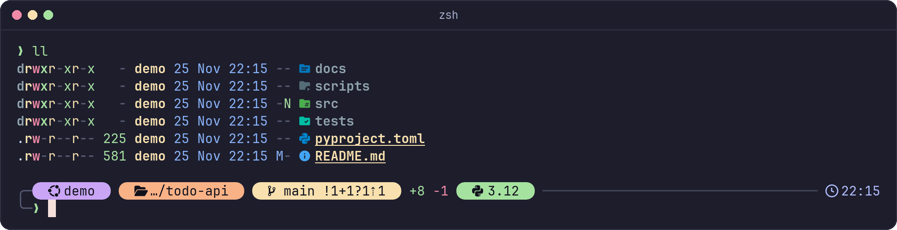
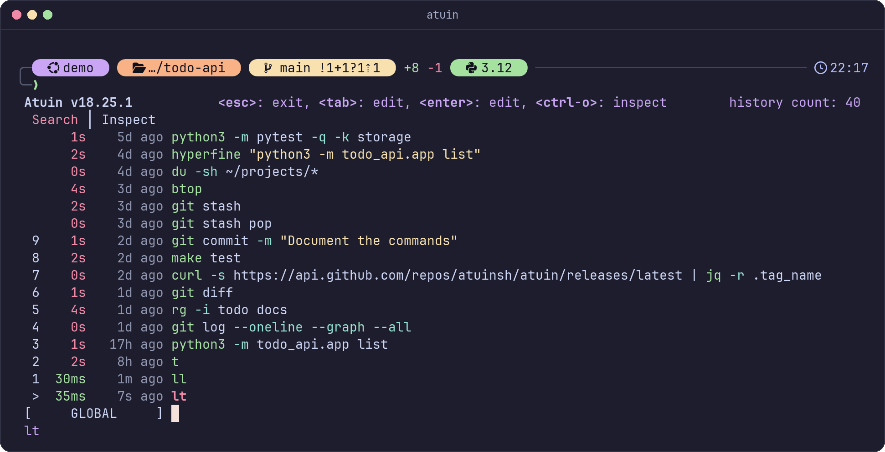
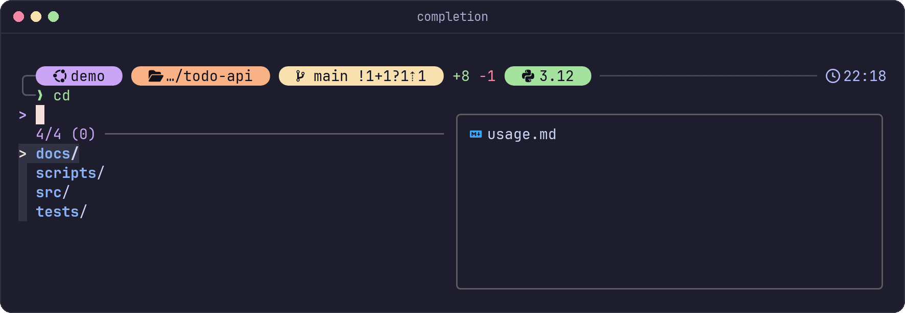
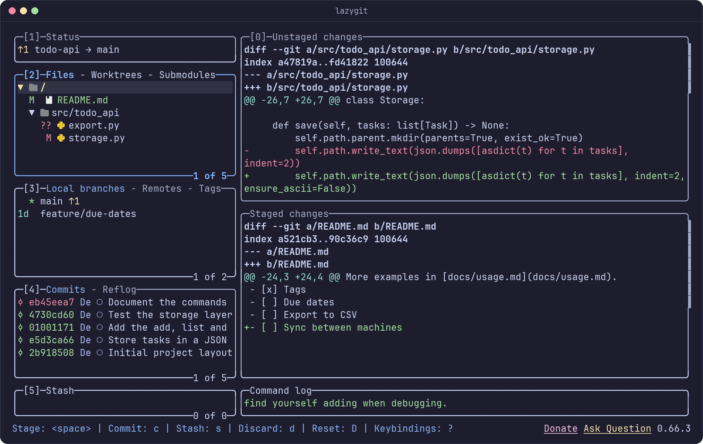
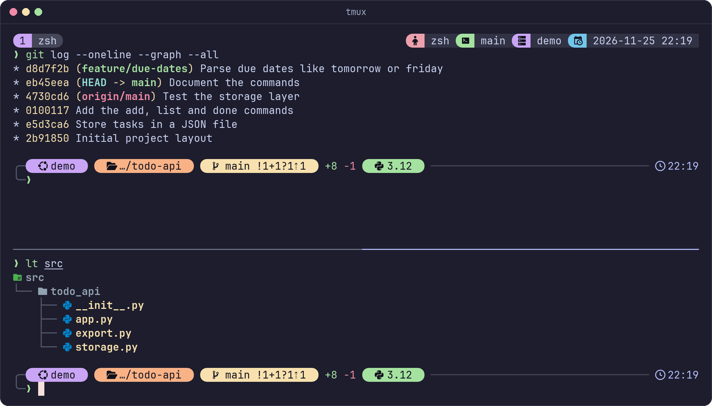

# Zsh + Starship terminal setup for Ubuntu, WSL and SSH (Catppuccin, eza Material icons)

[](https://github.com/Nameless0l/zsh-starship-catppuccin/actions/workflows/test.yml)

One script to turn a fresh Ubuntu terminal into a fast, good-looking and keyboard-friendly workspace: **Zsh**, a two-line **Starship** prompt in **Catppuccin Mocha**, **fzf** everywhere, **zoxide** smart `cd`, modern CLI tools (**eza**, **bat**, **fd**, **ripgrep**, **delta**, **lazygit**, **btop**, **tmux**, **atuin**, **tldr**) and file icons that look like the **VS Code Material Icon Theme**.

Three flavours of the same config:

- `setup-terminal.sh` for **Ubuntu desktop (GNOME)**, with a drop-down terminal and optional GNOME extensions
- `setup-terminal-wsl.sh` for **WSL** (Ubuntu on Windows, Windows Terminal)
- `setup-terminal-ssh.sh` for **headless servers and boards** reached over SSH (Ubuntu or Debian), works as a normal user with or without sudo, or as root

Every script can be run again safely: each file it replaces is first saved as `file.bak-YYYYMMDD-HHMMSS`.

> Script comments and messages are in French. [Version française du README](README.fr.md).



## Quick start

Run as your normal user (not with sudo, the script asks for it when needed). The SSH script can also run as root, for example on an embedded board.

On a minimal system without `curl`, install it first: `apt update && apt install -y curl` (as root) or with `sudo`.

Ubuntu desktop (GNOME):

```bash
bash <(curl -fsSL https://raw.githubusercontent.com/Nameless0l/zsh-starship-catppuccin/main/setup-terminal.sh)
```

WSL:

```bash
bash <(curl -fsSL https://raw.githubusercontent.com/Nameless0l/zsh-starship-catppuccin/main/setup-terminal-wsl.sh)
```

Server over SSH:

```bash
bash <(curl -fsSL https://raw.githubusercontent.com/Nameless0l/zsh-starship-catppuccin/main/setup-terminal-ssh.sh)
```

Then open a new terminal. Icons need a **Nerd Font** in the terminal you are looking at:

- Ubuntu desktop: JetBrainsMono Nerd Font is installed and applied to Ptyxis automatically (Medium, size 13), together with a Catppuccin Mocha color palette.
- WSL: on Windows, run `winget install -e --id DEVCOM.JetBrainsMonoNerdFont`. The script then sets this font and a Catppuccin Mocha color scheme in Windows Terminal's `settings.json` (backed up first). If that file contains comments it is left untouched: set the font and color scheme in Settings, Profiles, Appearance.
- SSH: install a Nerd Font on the computer you connect **from**, not on the server.

## What you get

Day-to-day use of every tool, with examples: **[user guide](docs/GUIDE.md)**.

### Terminal colors

- **Ptyxis** (Ubuntu desktop): a `Catppuccin Mocha` palette is added to `~/.local/share/org.gnome.Ptyxis/palettes/` and applied to every profile, replacing Ubuntu's aubergine background.
- **Windows Terminal** (WSL): the official Catppuccin Mocha scheme is added and applied to the Ubuntu and WSL profiles.

### Starship prompt (Catppuccin Mocha)

- Two-line prompt with a `╭─` / `╰─` frame, rounded "pill" segments and a line filling the gap
- OS icon, user, host (only over SSH), directory, git branch and detailed git status (`⇡2 !3 ?1`), added and deleted lines
- Language versions for C, Python, Node.js, PHP and Rust
- Right side: duration of long commands, exit code, background jobs, sudo indicator, time
- **Yocto / BitBake badge** when `oe-init-build-env` has been sourced (shows the build directory)
- **Transient prompt**: once a command runs, its prompt collapses to `❯ command`, so scrollback stays readable

### Zsh

- 100 000-line shared history with timestamps, no duplicates, `" command"` not saved
- **zsh-autosuggestions** (history and completion) and **zsh-syntax-highlighting**
- **fzf-tab**: Tab opens fzf with a preview of the folder content
- **zoxide replaces `cd`**: `cd doc` jumps to a folder you already visited, `cdi` picks one with fzf
- `↑` and `↓` only browse commands that start like what you typed
- Ctrl+← / Ctrl+→ by word, Ctrl+Backspace and Ctrl+Delete delete a word, Home and End work, Ctrl+X Ctrl+E edits the command in your editor
- Colored man pages
- Your own aliases and functions go in `~/.zshrc.local`, which the scripts never touch

### Modern command-line tools

- `ls`, `ll`, `la`, `lt` use **eza** (icons, git status, folders first, tree view)
- `cat` uses **bat** (syntax highlighting)
- `fd` (fd-find) and `rg` (ripgrep) for fast search, used by fzf and Ctrl+T
- **git-delta** for colored `git diff` with line numbers
- `lg` opens **lazygit** with a Catppuccin theme
- **btop** with the Catppuccin Mocha theme, **nvtop**, **fastfetch**, **glow**, **hyperfine**
- `t` opens the **tmux** session `main`, or reattaches to it, so it survives an SSH disconnect. Catppuccin status bar on top, mouse support, `Ctrl+B |` and `Ctrl+B -` split in the current folder, Alt+arrows move between panes
- **atuin** keeps your history in a local database: Ctrl+R searches it (fuzzy, with the folder and exit code of each command). Your zsh history is imported once, and `↑` keeps its prefix search. Encrypted sync between machines is optional: `atuin register`, then `atuin login` on the others
- `tldr tar` shows short, practical examples for a command (**tealdeer**, pages cached for offline use, Catppuccin colors)
- Tools missing from apt on the system (lazygit, fastfetch and glow on Ubuntu 24.04, delta on Debian 12), plus atuin and tldr, come from their latest GitHub release into `~/.local/bin`. A download is kept only if its SHA-256 matches the one GitHub publishes for that file and the binary runs on the machine

### fzf key bindings

- Ctrl+R: search history (atuin when installed, fzf otherwise)
- Ctrl+T: search a file, with a bat preview
- Alt+C: jump to a folder, with a tree preview

### eza icons like the VS Code Material Icon Theme

`eza/theme.yml` follows the whole mapping of the VS Code **Material Icon Theme**: about 1,200 file extensions and 3,800 file and folder names, spread over 820 Material icons, each with the exact color of its icon (read from its SVG file). Config files are recognized by name (`vite.config.ts`, `.prettierrc`, `Cargo.toml`, `docker-compose.yml`, `.pre-commit-config.yaml`...), and folders are colored by name like in VS Code (`src`, `docs`, `tests`, `.github`, `node_modules`, `migrations`, `Downloads`, French home folders...). Yocto files (`.bb`, `.bbappend`, `local.conf`) and device trees (`.dts`, `.dtb`) are covered too.

Glyphs come from Nerd Fonts, Material Design set first, then Devicons and Seti for brands Material Design lacks. When no glyph fits a Material icon (about 160 of them), eza keeps its own icon and takes the Material color. A terminal can only show single-color font glyphs, so the icons are not the VS Code SVGs themselves, but the result is close.

eza reads the theme on every call: `ls` takes about 15 ms with it instead of 2 ms, which you will not notice. It needs **eza 0.20 or newer**: the scripts install it from the official eza repository (deb.gierens.de) when Ubuntu ships an older version, as Ubuntu 24.04 does. They copy `eza/theme.yml` from the clone they run from, or download it from this repository.

To use only the theme:

```bash
mkdir -p ~/.config/eza
curl -fsSL -o ~/.config/eza/theme.yml https://raw.githubusercontent.com/Nameless0l/zsh-starship-catppuccin/main/eza/theme.yml
```

If `LS_COLORS` is set (it is on Ubuntu), eza lets it override the theme. The config clears it for eza only: `eza() { LS_COLORS= command eza "$@"; }`.

To rebuild the theme from the latest Material Icon Theme: `bash eza/build.sh`.

### GNOME extras (Ubuntu desktop only)

Set at the top of `setup-terminal.sh`, 1 to install and enable, 0 to skip:

- `EXT_QUAKE=1`: **Quake Terminal**, a drop-down Ptyxis on Super+Enter
- `EXT_TILING=0`: **Tiling Shell** (when enabled, Ubuntu's built-in tiling is turned off to avoid conflicts)
- `EXT_ASTRA=0`: **Astra Monitor**, CPU, RAM, NVIDIA GPU and temperature in the top bar

## Screenshots

History search with atuin (`Ctrl+R`):



Tab completion in fzf, with a preview of the selected folder:



lazygit (`lg`):



tmux with the Catppuccin bar (`t`):



The other tools are shown in the [user guide](docs/GUIDE.md).

## Config files

The three scripts share the same files in `config/`: `zshrc`, `starship.toml`, `lazygit.yml`, `tmux.conf`, `atuin/` and `tealdeer.toml`, plus `eza/theme.yml`. They copy them from the clone they run from, or download them from this repository when run through `curl`. An installed file is backed up and replaced only when its content changed.

## Tests

Every push runs `tests/lint.sh` (bash and zsh syntax, shellcheck, TOML) and then each script twice in a fresh container: the SSH script on Ubuntu 24.04 and Debian 12 as root and on Ubuntu 24.04 without sudo, the WSL script on Ubuntu 24.04 and the desktop script on Ubuntu 26.04 with sudo. `tests/check.sh` then checks the installed files, the zsh key bindings, the eza theme, tmux, atuin and tldr, and that the second run changed nothing. The same run happens every Monday, since the scripts fetch the latest releases of several tools.

To run one locally:

```bash
docker run --rm -v "$PWD:/repo:ro" ubuntu:24.04 bash /repo/tests/container.sh ssh root
```

## Requirements

- Ubuntu 24.04 or newer (a package missing from your release is skipped with a `[!!]` line)
- `sudo` for packages; without it the SSH script still installs Starship, the zsh plugins and the config in your home folder
- Internet access to the Ubuntu archive, GitHub and starship.rs
- Release binaries are available for x86_64, arm64 and 32-bit ARM (no atuin on 32-bit ARM)

## Undo

Every replaced file has a dated `.bak-...` copy next to it (`~/.zshrc`, `~/.config/starship.toml`, `~/.config/eza/theme.yml`, `~/.config/lazygit/config.yml`, `~/.config/tmux/tmux.conf`, `~/.config/atuin/config.toml`, `~/.config/tealdeer/config.toml`). Copy it back to return to your previous setup. To go back to bash: `chsh -s /bin/bash`.

## FAQ

**Icons show as squares or `�`.** The terminal font is not a Nerd Font. See Quick start.

**`ls` shows icons but not the Material colors.** Check `eza --version` (0.20 or newer is needed) and that `~/.config/eza/theme.yml` exists. eza silently ignores a theme file it cannot read.

**Can I keep my own aliases?** Yes, put them in `~/.zshrc.local`. `~/.shell_common` is loaded too, if you share aliases with bash.

**tmux keeps its old look.** A `~/.tmux.conf` takes priority over `~/.config/tmux/tmux.conf`: rename it, then run `tmux kill-server`.

**I prefer the fzf history search.** Remove atuin (`rm ~/.local/bin/atuin`): Ctrl+R goes back to fzf.

## Credits

[Starship](https://starship.rs), [Catppuccin](https://catppuccin.com), [eza](https://github.com/eza-community/eza), [Nerd Fonts](https://www.nerdfonts.com), [fzf](https://github.com/junegunn/fzf), [fzf-tab](https://github.com/Aloxaf/fzf-tab), [zoxide](https://github.com/ajeetdsouza/zoxide), [zsh-autosuggestions](https://github.com/zsh-users/zsh-autosuggestions), [zsh-syntax-highlighting](https://github.com/zsh-users/zsh-syntax-highlighting), [Material Icon Theme](https://github.com/material-extensions/vscode-material-icon-theme) for the icon colors, [tmux](https://github.com/tmux/tmux) with [catppuccin/tmux](https://github.com/catppuccin/tmux), [atuin](https://atuin.sh) with [catppuccin/atuin](https://github.com/catppuccin/atuin), [tealdeer](https://github.com/tealdeer-rs/tealdeer) and the [tldr pages](https://tldr.sh), [Quake Terminal](https://github.com/diegodario88/quake-terminal), [Tiling Shell](https://github.com/domferr/tilingshell), [Astra Monitor](https://github.com/AstraExt/astra-monitor).

## License

MIT
