# Guide d'utilisation

Comment se servir de chaque outil installé par les scripts. Tout est actif dans un terminal ouvert après l'installation.

> [English version](GUIDE.md) · [Retour au README](../README.fr.md)

- [Taper des commandes](#taper-des-commandes)
- [Se déplacer entre les dossiers](#se-déplacer-entre-les-dossiers)
- [Trouver des fichiers et du texte](#trouver-des-fichiers-et-du-texte)
- [L'historique avec atuin](#lhistorique-avec-atuin)
- [Lire et afficher des fichiers](#lire-et-afficher-des-fichiers)
- [Git : delta et lazygit](#git--delta-et-lazygit)
- [tmux : des sessions qui survivent](#tmux--des-sessions-qui-survivent)
- [Surveiller la machine](#surveiller-la-machine)
- [Lire le prompt](#lire-le-prompt)
- [Sous Windows (PowerShell 7)](#sous-windows-powershell-7)
- [Selon la machine](#selon-la-machine)

## Taper des commandes

### Retrouver une commande avec ↑ et ↓

Taper le début d'une commande puis `↑` : seules les commandes passées qui commencent de la même façon défilent.

```text
git p   puis ↑   →  git push origin main
             ↑   →  git pull --rebase
             ↓   →  revient à la précédente
```

Sans rien taper, `↑` parcourt tout l'historique, comme d'habitude.

### Suggestions grisées

Pendant la frappe, la suite la plus probable s'affiche en gris, tirée de l'historique et de la complétion.

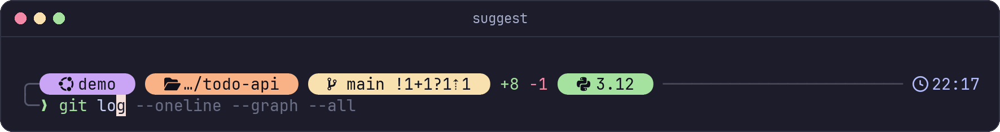

- `→` ou `Fin` : accepte toute la suggestion
- `Ctrl+→` : accepte seulement le mot suivant
- continuer à taper : la suggestion change ou disparaît

### Coloration de la commande

La commande se colore avant même d'appuyer sur Entrée : verte quand elle existe, rouge quand elle est inconnue (faute de frappe, outil non installé). Les chaînes entre guillemets et les chemins existants ont aussi leur couleur.

### Raccourcis d'édition

| Touche | Effet |
|---|---|
| `Ctrl+←` / `Ctrl+→` | Recule ou avance d'un mot |
| `Ctrl+Retour arrière` | Efface le mot avant le curseur |
| `Ctrl+Suppr` | Efface le mot après le curseur |
| `Début` / `Fin` | Début ou fin de la ligne |
| `Ctrl+X` puis `Ctrl+E` | Ouvre la ligne dans l'éditeur (`$EDITOR`), pratique pour une longue commande ; à la fermeture, la commande revient sur la ligne |

### Ne pas garder une commande

Une espace avant la commande la retire de l'historique, de zsh comme d'atuin :

```text
 export API_TOKEN=abc123      ← commence par une espace : rien n'est enregistré
```

### Aller dans un dossier sans taper `cd`

Un nom de dossier tapé seul, sans commande devant, suffit pour y entrer :

```text
~/projets/site $ ..          même effet que cd ..
~/projets $ site             même effet que cd site, si le dossier site existe ici
~ $ /etc                     même effet que cd /etc
```

`cd -` revient au dossier précédent.

### Réglages personnels

Les alias, fonctions et variables propres à une machine vont dans `~/.zshrc.local`. Les scripts ne touchent jamais ce fichier, et `~/.zshrc` le charge à la fin. Le relancer sans rouvrir le terminal : `source ~/.zshrc`.

## Se déplacer entre les dossiers

`cd` passe par **zoxide**, qui retient chaque dossier visité et la fréquence des visites. Ensuite, quelques lettres suffisent, depuis n'importe où :

```text
cd ~/projets/site-web/src     première visite : chemin complet, comme d'habitude
cd /tmp                       on part ailleurs
cd web                        → ~/projets/site-web, le dossier le plus visité qui contient « web »
cd site src                   plusieurs mots, dans l'ordre → ~/projets/site-web/src
cdi                           liste filtrable des dossiers connus, pour choisir
```

Un chemin qui existe (`cd ..`, `cd src`, `cd /etc`) marche exactement comme avant. zoxide ne sert que quand le nom ne correspond à aucun dossier du répertoire courant.

## Trouver des fichiers et du texte

### Tab : complétion dans une liste

`Tab` ouvre les complétions dans une liste filtrable : taper quelques lettres pour filtrer, `↑` et `↓` pour choisir, Entrée pour valider. Après `cd`, un aperçu montre le contenu de chaque dossier. Quand les résultats sont rangés par groupes (fichiers, options, commandes…), `<` et `>` passent d'un groupe à l'autre.

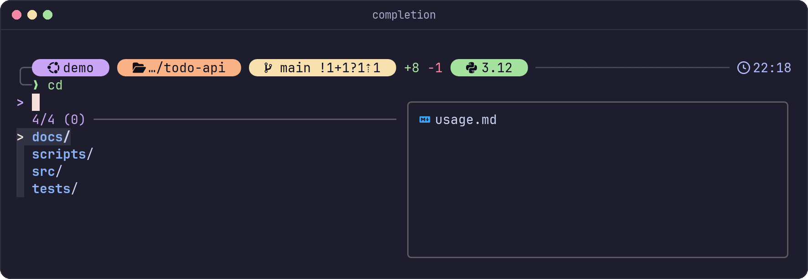

### Ctrl+T et Alt+C

- `Ctrl+T` cherche un fichier sous le dossier courant, avec un aperçu de son contenu, et colle son chemin dans la ligne. Exemple : taper `vim ` puis `Ctrl+T`, chercher `conf`, Entrée.
- `Alt+C` cherche un dossier, avec un aperçu en arbre, et y entre directement.

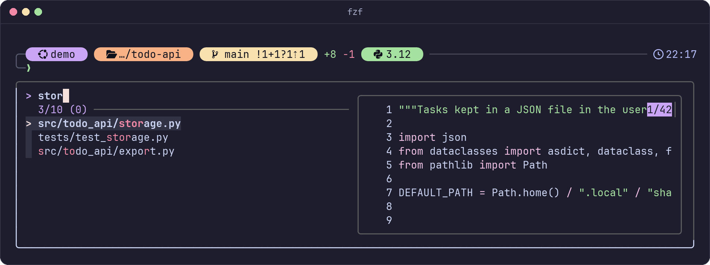

### fd : chercher par nom de fichier

```text
fd rapport                    fichiers et dossiers dont le nom contient « rapport », ici et en dessous
fd -e pdf                     tous les PDF
fd -e py test                 fichiers .py dont le nom contient « test »
fd -t d config                dossiers seulement
fd rapport ~/Documents        chercher dans un autre dossier
fd -H .env                    inclure les fichiers cachés
fd -I build                   inclure aussi ce que .gitignore exclut
```

### rg : chercher du texte dans les fichiers

```text
rg TODO                       chaque ligne qui contient TODO, avec le fichier et le numéro de ligne
rg -i erreur                  sans tenir compte des majuscules
rg -w port                    le mot entier « port », pas « export »
rg -t py import               seulement dans les fichiers Python
rg -l mot_de_passe            juste la liste des fichiers concernés
rg -C 2 "def main"            avec 2 lignes de contexte avant et après
```

Par défaut, `fd` et `rg` sautent les fichiers cachés et tout ce que `.gitignore` exclut (`node_modules/`, `target/`, `build/`…), d'où leur vitesse. `rg --hidden` ou `rg -uu` pour tout inclure.

## L'historique avec atuin

### Ce qu'atuin enregistre

Pour chaque commande, atuin garde dans une base locale :

- **le dossier** où elle a été lancée : on peut retrouver « la commande lancée dans ce projet » ;
- **la durée** : combien de temps elle a tourné ;
- **le code de retour** : le nombre que toute commande renvoie en finissant. `0` veut dire réussite, tout autre nombre une erreur (`1` erreur générale, `127` commande introuvable, `130` interrompue par `Ctrl+C`). On peut donc retrouver « la version de la commande qui a marché » ;
- la date, la machine et la session de terminal.

### La fenêtre de recherche (Ctrl+R)

`Ctrl+R` ouvre la recherche. Les lettres tapées n'ont pas besoin de se suivre : `dk run` trouve `docker run -it ubuntu`.

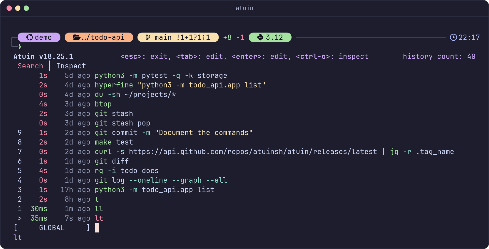

| Touche | Effet |
|---|---|
| `↑` / `↓` | Choisit une commande |
| `Entrée` ou `Tab` | Met la commande sur la ligne sans la lancer, pour la relire ou la modifier |
| `Ctrl+R` | Change le filtre (voir ci-dessous) |
| `Ctrl+S` | Change le mode de recherche : floue, par préfixe, texte exact |
| `Ctrl+O` | Ouvre la fiche de la commande choisie |
| `Ctrl+Y` | Copie la commande |
| `Échap` | Ferme la recherche |

`↑` dans le terminal garde la recherche par préfixe de zsh : atuin ne prend que `Ctrl+R`.

### Les filtres

Chaque `Ctrl+R` dans la fenêtre passe au filtre suivant. Le filtre actif s'affiche dans la fenêtre.

| Filtre | Ce qu'il montre | Quand s'en servir |
|---|---|---|
| global | Tout l'historique, toutes machines comprises si la synchronisation est activée | Par défaut |
| host | Seulement les commandes de cette machine | Avec la synchronisation, pour ne pas mélanger serveur et portable |
| session | Seulement ce terminal, depuis son ouverture | Retrouver ce qui vient d'être tapé dans cet onglet, sans les autres onglets |
| directory | Seulement les commandes lancées dans le dossier courant | Dans un projet, retrouver ses commandes de build, de test ou de lancement |
| workspace | Tout le dépôt git courant, quel que soit le sous-dossier | Pareil que directory, pour tout le projet |

### La fiche d'une commande (Ctrl+O)

La fiche montre combien de fois la commande a été lancée, sa durée moyenne, la part de réussites et les codes de retour obtenus, et son usage au fil du temps. Dans la fiche :

- `↑` et `↓` passent à la commande précédente ou suivante ;
- `Ctrl+D` **supprime** cette entrée de l'historique, par exemple un mot de passe tapé par erreur dans une commande ;
- `Ctrl+O` revient à la liste.

### Chercher en ligne de commande

```text
atuin search --exit 0 docker             commandes docker qui ont réussi
atuin search --exclude-exit 0 make       commandes make qui ont échoué
atuin search --cwd ~/projets/site npm    commandes npm lancées dans ce dossier
atuin search --after yesterday ssh       commandes ssh depuis hier
atuin stats                              commandes les plus utilisées
```

### Synchroniser plusieurs machines (facultatif)

Sans compte, tout reste sur la machine. Pour partager l'historique entre plusieurs machines, chiffré de bout en bout : `atuin register` sur la première, `atuin login` sur les autres, puis `atuin sync`. Les commandes qui contiennent un secret reconnu (clé AWS, jeton GitHub…) ne sont jamais enregistrées.

## Lire et afficher des fichiers

| Commande | Effet |
|---|---|
| `ls` | Liste avec icônes et couleurs façon VS Code, dossiers en premier |
| `ll` | Liste détaillée : droits, taille, date, et une colonne git (`M` modifié, `N` nouveau, `-` inchangé) |
| `la` | Comme `ll`, avec les fichiers cachés |
| `lt` | Arbre sur 2 niveaux, sans ce que `.gitignore` exclut |
| `cat fichier` | Affiche avec coloration syntaxique (bat) |
| `batcat fichier` | Pareil, dans un afficheur pour les longs fichiers : `q` pour quitter, `/` pour chercher |
| `glow README.md` | Affiche du Markdown mis en forme ; `glow` seul parcourt les `.md` du dossier |
| `man commande` | Pages de manuel en couleur |
| `tldr commande` | Quelques exemples concrets plutôt que tout le manuel : `tldr tar`, `tldr find`, `tldr ffmpeg` |

Les pages tldr restent en cache pour marcher hors ligne et se mettent à jour seules tous les 30 jours (`tldr --update` pour forcer).

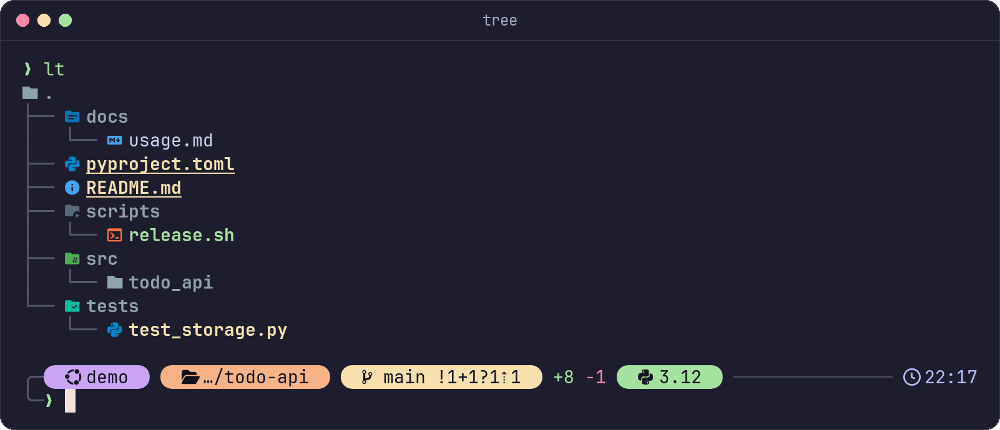

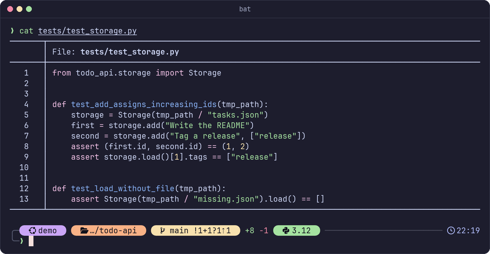

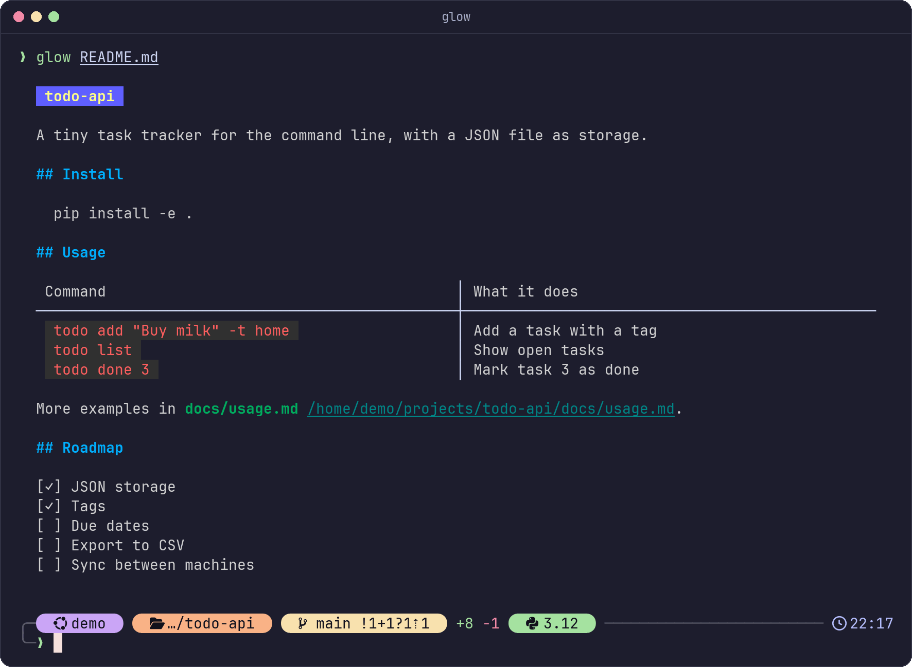

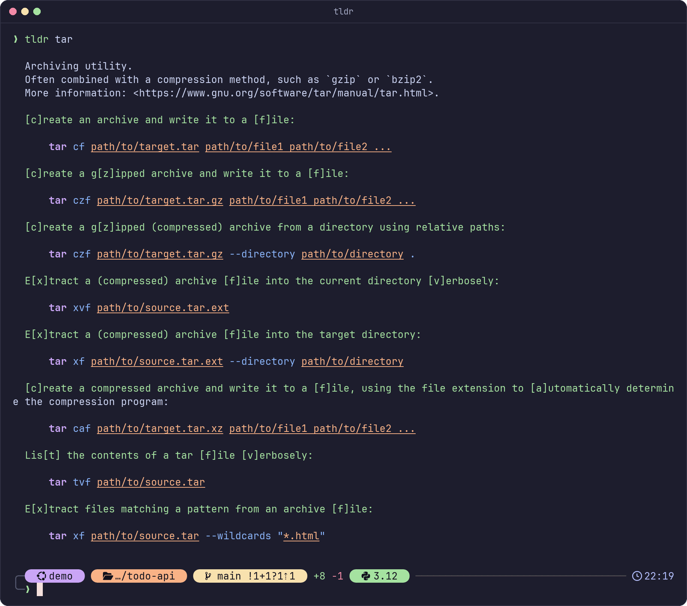

## Git : delta et lazygit

### delta

`git diff`, `git show` et `git log -p` passent par delta : coloration syntaxique, numéros de ligne, mots modifiés surlignés. Dans l'affichage, `n` et `N` sautent au fichier suivant ou précédent, `q` quitte.

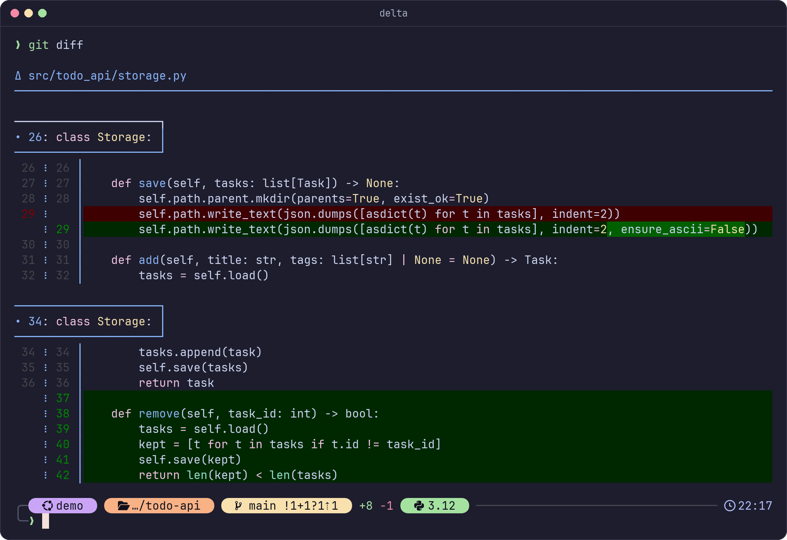

### lazygit (`lg`)

lazygit est une interface complète pour git dans le terminal. Le lancer dans un dépôt : `lg`.

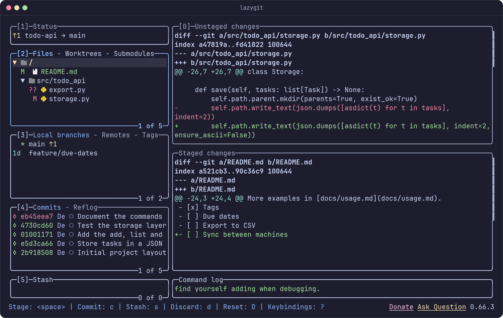

**L'écran.** À gauche, cinq panneaux numérotés. À droite, le détail de ce qui est sélectionné (diff d'un fichier, contenu d'un commit). En bas, les touches utiles du panneau courant.

| Panneau | Contenu |
|---|---|
| `1` Status | Le dépôt et la branche courante |
| `2` Files | Les fichiers modifiés, prêts à être ajoutés ou non |
| `3` Branches | Les branches locales et distantes, et les tags |
| `4` Commits | L'historique de la branche |
| `5` Stash | Les modifications mises de côté |

On passe d'un panneau à l'autre avec son numéro ou `←` et `→`, et on se déplace dedans avec `↑` et `↓`. `?` affiche toutes les touches du panneau courant, `Échap` revient en arrière, `q` quitte.

**Faire un commit, pas à pas.**

1. `2` pour aller dans Files.
2. `espace` sur un fichier pour l'ajouter au commit (il passe en vert), ou `a` pour tout ajouter.
3. Pour n'ajouter qu'une partie d'un fichier : `Entrée` sur le fichier, puis `↑` et `↓` pour choisir une ligne et `espace` pour l'ajouter. `a` bascule entre ligne et bloc entier, `v` sélectionne plusieurs lignes, `Échap` revient à la liste.
4. `c`, écrire le message, `Entrée`.
5. `P` pour pousser vers le serveur, `p` pour récupérer les nouveautés.

**Autres gestes utiles.**

| Où | Touche | Effet |
|---|---|---|
| Files | `d` | Annule les modifications d'un fichier (menu de confirmation) |
| Files | `A` | Ajoute le contenu préparé au dernier commit (amend) |
| Files | `s` | Met toutes les modifications de côté (stash) |
| Branches | `n` | Crée une branche |
| Branches | `espace` | Passe sur la branche sélectionnée |
| Branches | `M` | Fusionne la branche sélectionnée dans la branche courante |
| Branches | `r` | Rebase la branche courante sur la sélectionnée |
| Branches | `d` | Supprime la branche |
| Commits | `Entrée` | Montre les fichiers du commit |
| Commits | `r` | Change le message du commit |
| Commits | `s` | Fusionne le commit dans celui du dessous (squash) |
| Commits | `t` | Crée un commit qui annule celui-ci (revert) |
| Commits | `g` | Revient à ce commit (reset, avec le choix soft, mixed ou hard) |
| Partout | `z` / `Z` | Annule ou refait la dernière action |
| Partout | `/` | Cherche dans la liste |

## tmux : des sessions qui survivent

### Les idées

- Une **session** est un espace de travail qui continue de tourner même quand le terminal se ferme ou que la connexion SSH coupe.
- Une session contient des **fenêtres**, comme des onglets, affichées dans la barre du haut.
- Une fenêtre se découpe en **panneaux**, plusieurs terminaux côte à côte.

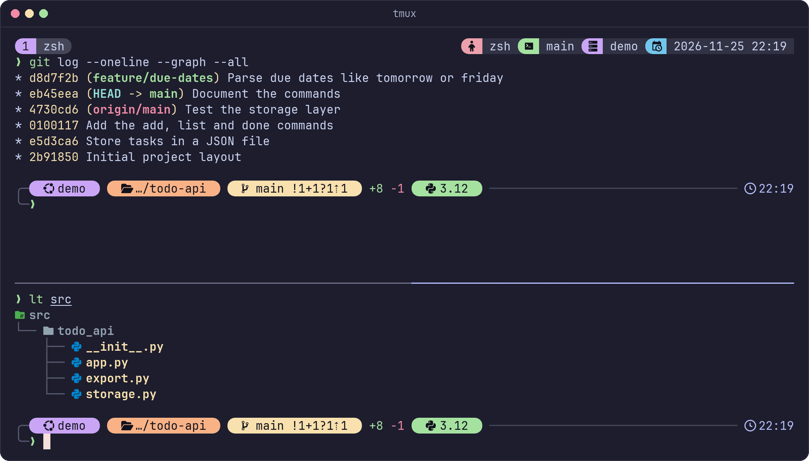

### Démarrer et reprendre

```text
t                       ouvre la session « main », ou la rejoint si elle existe déjà
Ctrl+B puis d           se détacher : tout continue de tourner en arrière-plan
t                       plus tard, ou après une coupure SSH : on retrouve tout
tmux ls                 liste des sessions
tmux new -s autre       une deuxième session nommée « autre »
tmux a -t autre         rejoindre la session « autre »
```

Exemple : lancer une longue compilation sur un serveur dans `t`, fermer l'ordinateur, se reconnecter le lendemain, taper `t` : la compilation a continué et son affichage est là.

### Les raccourcis

Ils commencent tous par `Ctrl+B`, qu'on relâche avant d'appuyer sur la touche suivante.

| Après `Ctrl+B` | Effet |
|---|---|
| `\|` | Coupe en deux panneaux côte à côte, dans le même dossier |
| `-` | Coupe en deux panneaux l'un au-dessus de l'autre |
| `z` | Agrandit le panneau courant en plein écran, ou le remet en place |
| `x` | Ferme le panneau courant (après confirmation) |
| `c` | Nouvelle fenêtre |
| `1`, `2`… | Va à la fenêtre de ce numéro |
| `n` / `p` | Fenêtre suivante ou précédente |
| `,` | Renomme la fenêtre |
| `[` | Mode défilement : `↑`, `↓`, `PgPréc`, `PgSuiv`, `q` pour sortir |
| `d` | Se détacher de la session |
| `r` | Recharge la configuration |

Sans préfixe : `Alt+flèches` passe d'un panneau à l'autre, et `exit` ferme le panneau courant.

### La souris

Un clic choisit un panneau, la molette fait défiler, glisser une bordure redimensionne. Pour sélectionner du texte avec la sélection normale du terminal, garder `Maj` enfoncée pendant le glissé.

## Surveiller la machine

| Commande | Effet |
|---|---|
| `btop` | Processeur, mémoire, disques, réseau et processus. `↑` et `↓` choisissent un processus, `f` filtre, `k` le termine, `q` quitte |
| `nvtop` | La même chose pour une carte graphique NVIDIA |
| `fastfetch` | Résumé de la machine : système, noyau, processeur, mémoire, disque. Utile pour savoir sur quelle machine on est en SSH |
| `hyperfine 'cmd1' 'cmd2'` | Lance chaque commande plusieurs fois et compare leurs durées |

Exemple : `hyperfine 'fd -e py' 'find . -name "*.py"'`.

## Lire le prompt

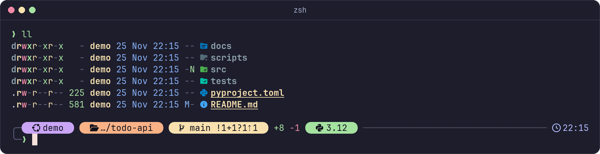

Sans les icônes, il ressemble à ceci :

```text
╭─ user  ~/projets/site  main !2 ?1 ⇡1  +12 -3 ──────────────  3s  1  12:30
╰─❯
```

À gauche :

- le système, l'utilisateur, et le nom de la machine seulement en SSH ;
- le dossier courant ;
- la branche git, puis son état :

| Symbole | Sens |
|---|---|
| `!2` | 2 fichiers modifiés, pas encore ajoutés |
| `+1` | 1 fichier ajouté, prêt pour le commit |
| `?1` | 1 fichier nouveau que git ne suit pas |
| `✘1` | 1 fichier supprimé |
| `⇡1` / `⇣2` | 1 commit à pousser / 2 commits à récupérer |
| `≡1` | 1 stash |

- `+12 -3` : lignes ajoutées et supprimées depuis le dernier commit ;
- la version du langage du projet (Python, Node.js, Rust, PHP, C) quand le dossier en contient.

À droite : la durée de la dernière commande quand elle dépasse 2 secondes, son code de retour quand il n'est pas `0`, le nombre de tâches en arrière-plan, une icône quand sudo ne redemandera pas le mot de passe, et l'heure.

Une fois la commande validée, son prompt se réduit à `❯ commande`, ce qui garde l'historique de l'écran lisible.

## Sous Windows (PowerShell 7)

`setup-terminal-windows.ps1` installe PowerShell 7 à la place de zsh, avec le même prompt, les mêmes outils et les mêmes fichiers de config. L'essentiel de ce guide s'applique tel quel : `↑` et `↓`, les touches d'édition, l'espace en tête pour garder une commande hors de l'historique, `cd` et `cdi`, Ctrl+R dans atuin, Ctrl+T et Alt+C, les outils pour les fichiers et git, et le prompt.

Ce qui change :

- les suggestions grisées viennent de l'historique seulement : `→` les accepte, `Ctrl+→` en prend un mot ;
- `Tab` ouvre les complétions dans fzf avec un aperçu à droite, et `Ctrl+/` le passe en dessous ou le cache ;
- un nom de dossier tapé seul n'y entre pas, il faut `cd` ;
- pas de tmux, btop, nvtop ni pages man en couleur. Windows Terminal a des onglets et des panneaux à la place : `Ctrl+Shift+T` ouvre un onglet, `Alt+Shift+D` coupe le panneau, `Alt+flèches` passe d'un panneau à l'autre, `Ctrl+Shift+W` en ferme un ;
- les réglages perso vont dans `profile.local.ps1`, à côté du profil : `notepad (Join-Path (Split-Path $PROFILE) profile.local.ps1)`. Pour recharger : `. $PROFILE`.

## Selon la machine

- **Ubuntu avec GNOME** : `Super+Entrée` fait descendre un terminal depuis le haut de l'écran, le même raccourci le cache. La police Nerd Font et les couleurs Catppuccin sont réglées dans Ptyxis.
- **WSL** : les icônes viennent de la police de Windows Terminal. Si elle manque, dans PowerShell : `winget install -e --id DEVCOM.JetBrainsMonoNerdFont`.
- **SSH** : les icônes viennent du terminal de l'ordinateur depuis lequel on se connecte, c'est donc là qu'il faut une Nerd Font. tmux (`t`) y est le plus utile, pour ne rien perdre en cas de coupure.
