# User guide

How to use each tool the scripts install. Everything works in a terminal opened after the install.

> [Version française](GUIDE.fr.md) · [Back to the README](../README.md)

- [Typing commands](#typing-commands)
- [Moving between folders](#moving-between-folders)
- [Finding files and text](#finding-files-and-text)
- [History with atuin](#history-with-atuin)
- [Reading and viewing files](#reading-and-viewing-files)
- [Git: delta and lazygit](#git-delta-and-lazygit)
- [tmux: sessions that survive](#tmux-sessions-that-survive)
- [Watching the machine](#watching-the-machine)
- [Reading the prompt](#reading-the-prompt)
- [On Windows (PowerShell 7)](#on-windows-powershell-7)
- [Per machine](#per-machine)

## Typing commands

### Find a command again with ↑ and ↓

Type the start of a command, then `↑`: only past commands that start the same way come up.

```text
git p   then ↑   →  git push origin main
             ↑   →  git pull --rebase
             ↓   →  back to the previous one
```

With nothing typed, `↑` walks through the whole history as usual.

### Gray suggestions

While typing, the most likely ending shows in gray, taken from the history and from completion.

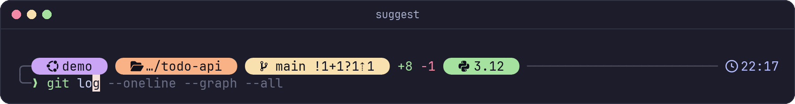

- `→` or `End`: accept the whole suggestion
- `Ctrl+→`: accept the next word only
- keep typing: the suggestion changes or goes away

### Command coloring

The command is colored before Enter is pressed: green when it exists, red when it is unknown (a typo, a tool that is not installed). Quoted strings and existing paths get their own color too.

### Editing keys

| Key | Effect |
|---|---|
| `Ctrl+←` / `Ctrl+→` | Move one word back or forward |
| `Ctrl+Backspace` | Delete the word before the cursor |
| `Ctrl+Delete` | Delete the word after the cursor |
| `Home` / `End` | Start or end of the line |
| `Ctrl+X` then `Ctrl+E` | Open the line in the editor (`$EDITOR`), handy for a long command; on exit, the command comes back to the line |

### Keep a command out of the history

A space before a command keeps it out of the history, in zsh and in atuin:

```text
 export API_TOKEN=abc123      ← starts with a space: nothing is saved
```

### Enter a folder without typing `cd`

A folder name typed alone, with no command before it, is enough to go into it:

```text
~/projects/site $ ..         same as cd ..
~/projects $ site            same as cd site, if the folder site exists here
~ $ /etc                     same as cd /etc
```

`cd -` goes back to the previous folder.

### Personal settings

Aliases, functions and variables specific to one machine go in `~/.zshrc.local`. The scripts never touch that file, and `~/.zshrc` loads it at the end. Reload without reopening the terminal: `source ~/.zshrc`.

## Moving between folders

`cd` goes through **zoxide**, which remembers every folder visited and how often. After that, a few letters are enough, from anywhere:

```text
cd ~/projects/website/src     first visit: full path, as usual
cd /tmp                       go somewhere else
cd web                        → ~/projects/website, the most visited folder matching "web"
cd site src                   several words, in order → ~/projects/website/src
cdi                           filterable list of known folders, to pick one
```

A path that exists (`cd ..`, `cd src`, `cd /etc`) works exactly as before. zoxide only kicks in when the name matches no folder in the current directory.

## Finding files and text

### Tab: completion in a list

`Tab` opens completions in a filterable list: type a few letters to filter, `↑` and `↓` to choose, Enter to accept. After `cd`, a preview shows what each folder contains. When results are grouped (files, options, commands...), `<` and `>` switch between groups.

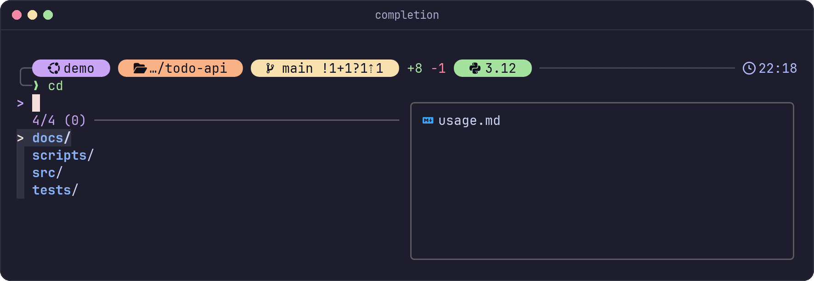

### Ctrl+T and Alt+C

- `Ctrl+T` searches for a file under the current folder, with a preview of its content, and pastes its path into the line. Example: type `vim `, then `Ctrl+T`, search `conf`, Enter.
- `Alt+C` searches for a folder, with a tree preview, and goes into it.

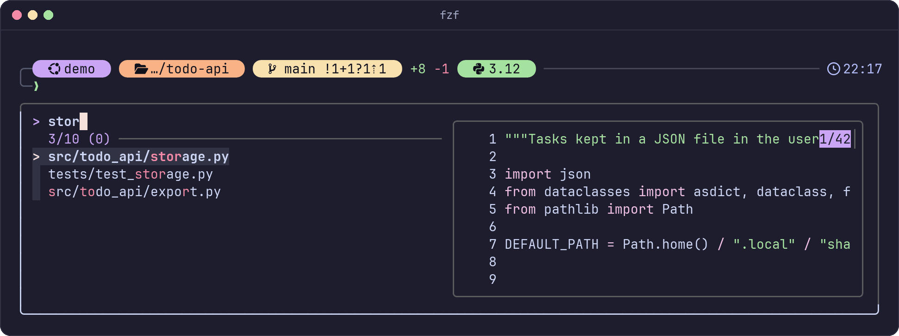

### fd: search by file name

```text
fd report                     files and folders whose name contains "report", here and below
fd -e pdf                     every PDF
fd -e py test                 .py files whose name contains "test"
fd -t d config                folders only
fd report ~/Documents         search in another folder
fd -H .env                    include hidden files
fd -I build                   also include what .gitignore excludes
```

### rg: search text inside files

```text
rg TODO                       every line containing TODO, with file name and line number
rg -i error                   ignore case
rg -w port                    the whole word "port", not "export"
rg -t py import               Python files only
rg -l password                only the list of matching files
rg -C 2 "def main"            with 2 lines of context before and after
```

By default `fd` and `rg` skip hidden files and everything `.gitignore` excludes (`node_modules/`, `target/`, `build/`...), which is why they are fast. `rg --hidden` or `rg -uu` includes everything.

## History with atuin

### What atuin records

For each command, atuin keeps in a local database:

- **the folder** it ran in, so "the command I ran in this project" can be found;
- **the duration**, how long it ran;
- **the exit code**, the number every command returns when it ends. `0` means success, any other number an error (`1` general error, `127` command not found, `130` stopped with `Ctrl+C`). This finds "the version of the command that worked";
- the date, the machine and the terminal session.

### The search window (Ctrl+R)

`Ctrl+R` opens the search. Typed letters do not need to be next to each other: `dk run` finds `docker run -it ubuntu`.

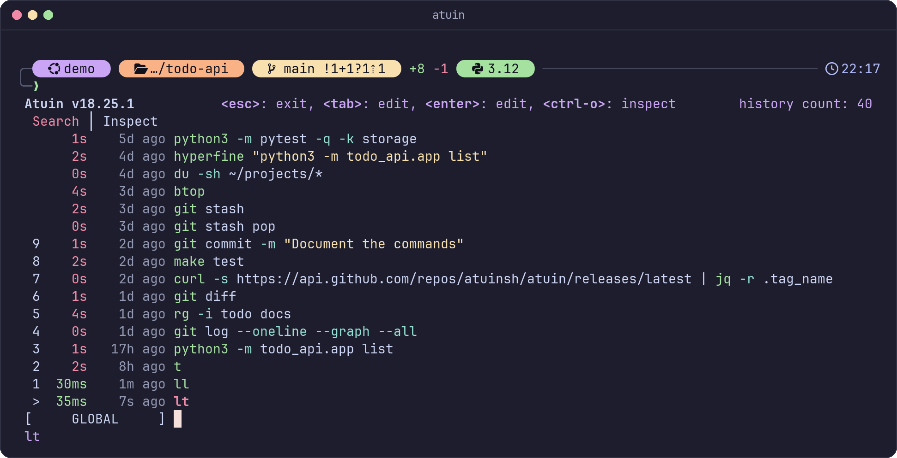

| Key | Effect |
|---|---|
| `↑` / `↓` | Choose a command |
| `Enter` or `Tab` | Put the command on the line without running it, to read or edit it first |
| `Ctrl+R` | Change the filter (see below) |
| `Ctrl+S` | Change the search mode: fuzzy, prefix, exact text |
| `Ctrl+O` | Open the details of the chosen command |
| `Ctrl+Y` | Copy the command |
| `Esc` | Close the search |

`↑` in the terminal keeps zsh's prefix search: atuin only takes `Ctrl+R`.

### Filters

Each `Ctrl+R` inside the window moves to the next filter. The active filter is shown in the window.

| Filter | What it shows | When to use it |
|---|---|---|
| global | The whole history, all machines included when sync is on | Default |
| host | Only commands from this machine | With sync, to keep server and laptop apart |
| session | Only this terminal, since it was opened | Find what was just typed in this tab, without the other tabs |
| directory | Only commands run in the current folder | In a project, find its build, test or run commands |
| workspace | The whole current git repository, from any subfolder | Like directory, for the whole project |

### Command details (Ctrl+O)

The details show how many times the command ran, its average duration, the share of successes and the exit codes seen, and its use over time. In the details:

- `↑` and `↓` move to the previous or next command;
- `Ctrl+D` **deletes** this entry from the history, for example a password typed into a command by mistake;
- `Ctrl+O` goes back to the list.

### Search from the command line

```text
atuin search --exit 0 docker              docker commands that succeeded
atuin search --exclude-exit 0 make        make commands that failed
atuin search --cwd ~/projects/site npm    npm commands run in that folder
atuin search --after yesterday ssh        ssh commands since yesterday
atuin stats                               most used commands
```

### Sync several machines (optional)

Without an account, everything stays on the machine. To share the history between machines, end-to-end encrypted: `atuin register` on the first one, `atuin login` on the others, then `atuin sync`. Commands containing a known kind of secret (AWS key, GitHub token...) are never saved.

## Reading and viewing files

| Command | Effect |
|---|---|
| `ls` | List with VS Code style icons and colors, folders first |
| `ll` | Long list: permissions, size, date, and a git column (`M` modified, `N` new, `-` unchanged) |
| `la` | Like `ll`, with hidden files |
| `lt` | Tree, 2 levels deep, without what `.gitignore` excludes |
| `cat file` | Print with syntax highlighting (bat) |
| `batcat file` | Same, in a pager for long files: `q` to quit, `/` to search |
| `glow README.md` | Render Markdown; `glow` alone browses the `.md` files of the folder |
| `man command` | Manual pages in color |
| `tldr command` | A few practical examples instead of the whole manual: `tldr tar`, `tldr find`, `tldr ffmpeg` |

tldr pages are cached for offline use and update themselves every 30 days (`tldr --update` to force it).

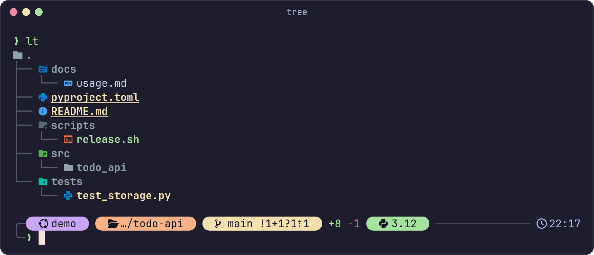

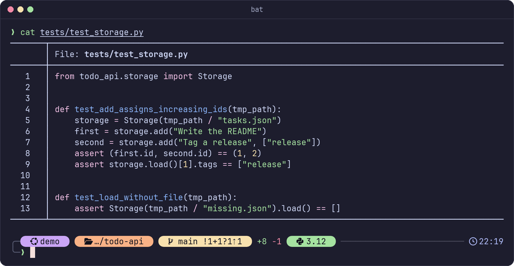

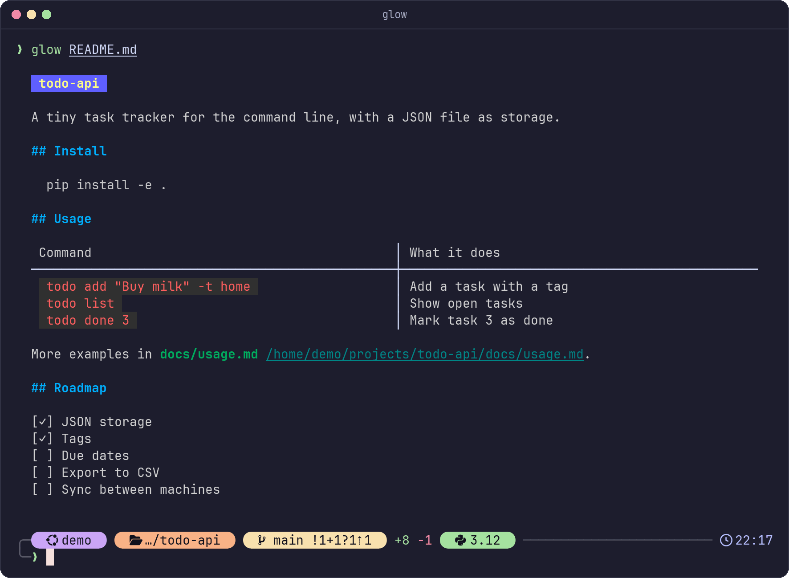

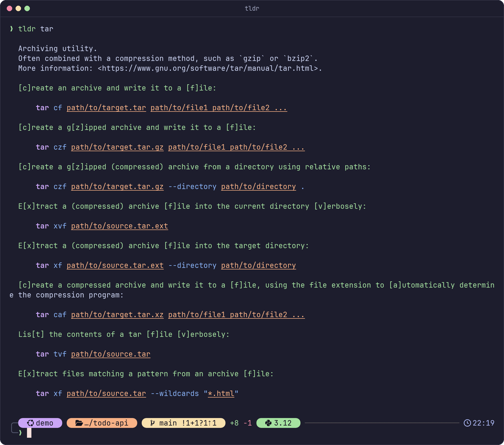

## Git: delta and lazygit

### delta

`git diff`, `git show` and `git log -p` go through delta: syntax highlighting, line numbers, changed words highlighted. In the view, `n` and `N` jump to the next or previous file, `q` quits.

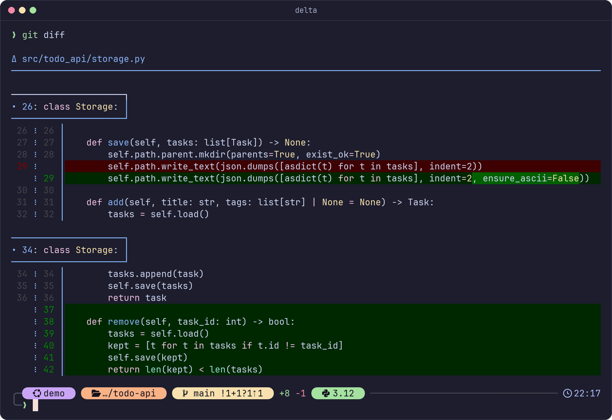

### lazygit (`lg`)

lazygit is a full git interface in the terminal. Start it in a repository: `lg`.

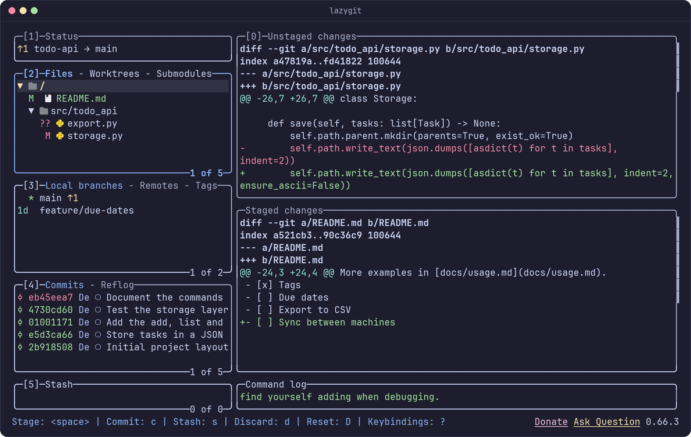

**The screen.** On the left, five numbered panels. On the right, the details of what is selected (a file's diff, a commit's content). At the bottom, the useful keys for the current panel.

| Panel | Content |
|---|---|
| `1` Status | The repository and the current branch |
| `2` Files | Changed files, staged or not |
| `3` Branches | Local and remote branches, and tags |
| `4` Commits | The branch history |
| `5` Stash | Changes put aside |

Move between panels with their number or `←` and `→`, and inside one with `↑` and `↓`. `?` lists every key of the current panel, `Esc` goes back, `q` quits.

**Making a commit, step by step.**

1. `2` to go to Files.
2. `space` on a file to stage it (it turns green), or `a` to stage everything.
3. To stage only part of a file: `Enter` on the file, then `↑` and `↓` to pick a line and `space` to stage it. `a` switches between line and whole hunk, `v` selects several lines, `Esc` goes back to the list.
4. `c`, type the message, `Enter`.
5. `P` to push to the server, `p` to pull new changes.

**Other useful keys.**

| Where | Key | Effect |
|---|---|---|
| Files | `d` | Discard a file's changes (with a confirmation menu) |
| Files | `A` | Add the staged content to the last commit (amend) |
| Files | `s` | Stash all changes |
| Branches | `n` | New branch |
| Branches | `space` | Check out the selected branch |
| Branches | `M` | Merge the selected branch into the current one |
| Branches | `r` | Rebase the current branch onto the selected one |
| Branches | `d` | Delete the branch |
| Commits | `Enter` | Show the commit's files |
| Commits | `r` | Reword the commit message |
| Commits | `s` | Squash the commit into the one below |
| Commits | `t` | Revert: a new commit that undoes this one |
| Commits | `g` | Reset to this commit (soft, mixed or hard) |
| Anywhere | `z` / `Z` | Undo or redo the last action |
| Anywhere | `/` | Search the list |

## tmux: sessions that survive

### The ideas

- A **session** is a workspace that keeps running when the terminal closes or the SSH connection drops.
- A session holds **windows**, like tabs, shown in the top bar.
- A window splits into **panes**, several terminals side by side.

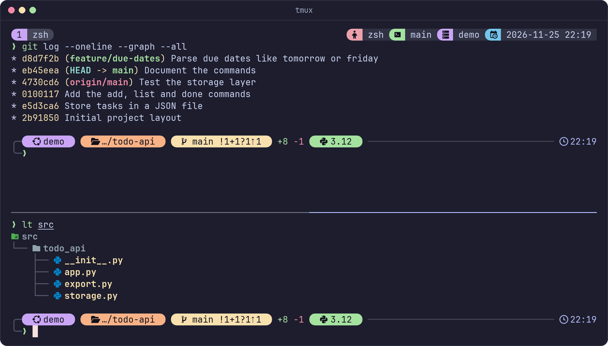

### Start and resume

```text
t                       open the "main" session, or join it if it already exists
Ctrl+B then d           detach: everything keeps running in the background
t                       later, or after an SSH drop: everything is still there
tmux ls                 list sessions
tmux new -s other       a second session named "other"
tmux a -t other         join the "other" session
```

Example: start a long build on a server inside `t`, close the laptop, reconnect the next day, type `t`: the build kept going and its output is there.

### Keys

They all start with `Ctrl+B`, released before pressing the next key.

| After `Ctrl+B` | Effect |
|---|---|
| `\|` | Split into two panes side by side, in the same folder |
| `-` | Split into two panes, one above the other |
| `z` | Zoom the current pane to full screen, or back |
| `x` | Close the current pane (after confirmation) |
| `c` | New window |
| `1`, `2`... | Go to that window |
| `n` / `p` | Next or previous window |
| `,` | Rename the window |
| `[` | Scroll mode: `↑`, `↓`, `PgUp`, `PgDn`, `q` to leave |
| `d` | Detach from the session |
| `r` | Reload the config |

Without the prefix: `Alt+arrows` moves between panes, and `exit` closes the current pane.

### Mouse

A click picks a pane, the wheel scrolls, dragging a border resizes. To select text with the terminal's own selection, hold `Shift` while dragging.

## Watching the machine

| Command | Effect |
|---|---|
| `btop` | CPU, memory, disks, network and processes. `↑` and `↓` pick a process, `f` filters, `k` ends it, `q` quits |
| `nvtop` | The same for an NVIDIA graphics card |
| `fastfetch` | Machine summary: system, kernel, CPU, memory, disk. Useful to know which machine an SSH session is on |
| `hyperfine 'cmd1' 'cmd2'` | Run each command several times and compare their durations |

Example: `hyperfine 'fd -e py' 'find . -name "*.py"'`.

## Reading the prompt

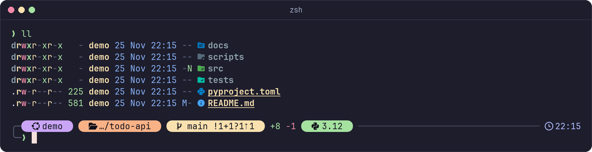

Without the icons, it looks like this:

```text
╭─ user  ~/projects/site  main !2 ?1 ⇡1  +12 -3 ──────────────  3s  1  12:30
╰─❯
```

On the left:

- the system, the user, and the machine name over SSH only;
- the current folder;
- the git branch, then its state:

| Symbol | Meaning |
|---|---|
| `!2` | 2 changed files, not staged yet |
| `+1` | 1 staged file, ready to commit |
| `?1` | 1 new file git does not track |
| `✘1` | 1 deleted file |
| `⇡1` / `⇣2` | 1 commit to push / 2 commits to pull |
| `≡1` | 1 stash |

- `+12 -3`: lines added and removed since the last commit;
- the project's language version (Python, Node.js, Rust, PHP, C) when the folder has one.

On the right: the last command's duration when it took more than 2 seconds, its exit code when it is not `0`, the number of background jobs, an icon while sudo will not ask for the password again, and the time.

Once a command runs, its prompt shrinks to `❯ command`, which keeps the screen history readable.

## On Windows (PowerShell 7)

`setup-terminal-windows.ps1` sets up PowerShell 7 instead of zsh, with the same prompt, tools and config files. Most of this guide applies as is: `↑` and `↓`, the editing keys, a leading space to keep a command out of the history, `cd` and `cdi`, Ctrl+R in atuin, Ctrl+T and Alt+C, the file and git tools, and the prompt.

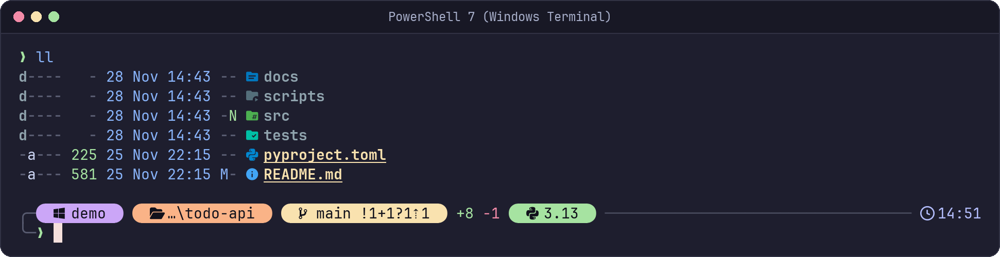

What changes:

- gray suggestions come from the history only: `→` accepts them, `Ctrl+→` takes one word;
- `Tab` opens the completions in fzf, without a preview for now: PSFzf cannot start it on Windows ([PSFzf bug](https://github.com/kelleyma49/PSFzf/issues/380));
- a folder name typed alone does not enter it, `cd` is needed;
- no tmux, btop, nvtop or colored man pages. Windows Terminal has tabs and panes instead: `Ctrl+Shift+T` opens a tab, `Alt+Shift+D` splits the pane, `Alt+arrows` move between panes, `Ctrl+Shift+W` closes one;
- personal settings go in `profile.local.ps1`, next to the profile: `notepad (Join-Path (Split-Path $PROFILE) profile.local.ps1)`. Reload with `. $PROFILE`.

A gray suggestion from the history:


Ctrl+T, with the bat preview:

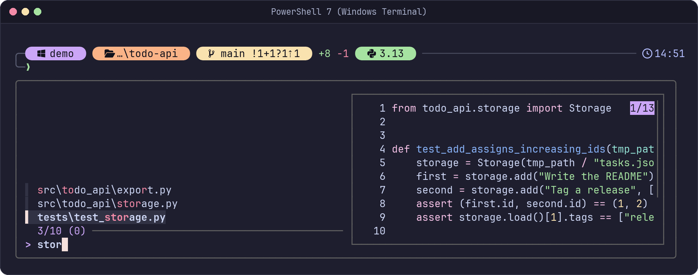

## Per machine

- **Ubuntu with GNOME**: `Super+Enter` drops a terminal down from the top of the screen, the same shortcut hides it. The Nerd Font and the Catppuccin colors are set in Ptyxis.
- **WSL**: icons come from the Windows Terminal font. If it is missing, in PowerShell: `winget install -e --id DEVCOM.JetBrainsMonoNerdFont`.
- **SSH**: icons come from the terminal of the computer you connect from, so that is where a Nerd Font is needed. tmux (`t`) is the most useful there, to lose nothing when the connection drops.
